# Village Town Castle の生成ロジック

Village、Town、Castleの生成を、設定の読み込みから地形・道路・建物の計画、候補選択、3D化まで順に説明する。**TownとCastleの城下町は、同じ集落生成関数を都市モードで使う。Villageも、その関数を村モードで使う。** Castle固有の処理は、街を置く前の城郭生成と、街を置いた後の城郭への統合・室内計画である。

対象はエディターが使用する `assetFoundation=1` の経路。これは実際に登録されている建物アセットの寸法・扉位置に合わせて配置を計画する方式である。基準は2026年11月3日に確認した実装で、`assetFoundation=0` の通常CLI経路は対象外。

12個のMermaid図、用語、条件、採点式、補足をこの文書内に収録している。実装ファイル名はコードを確認したい場合の手掛かりであり、処理の説明は本文内で完結する。

**最終照合：2026年11月3日。** 作成時の本文と、更新後のエディター・生成器の作業ツリーを比較して更新した。比較元は保存済みの文書であり、特定の旧コミットとのコード差分ではない。主な変更は、裕福度に応じた公共設備と首長邸を一般住宅より先に確保する処理である。

## 目次

| 節 | 読み取れること |
|---|---|
| [作成時からの主な変更](#更新差分) | 公共設備・首長邸の追加と、成功条件・3D配置の変化 |
| [生成の考え方と図の読み方](#読み方) | 平面計画と3D化の違い、共通処理、図の記号 |
| [候補ループを区別する](#候補ループ) | 画像10枚・街候補・城全体候補の関係 |
| [種類ごとの条件](#種類ごとの条件) | Village、Town、Castleの城下町へ渡す設定の差 |
| [主なデータと用語](#主なデータ) | Plan、配置範囲、道路階層、領域、入口 |
| [O 全体フロー](#全体フロー) | TownとCastleの城下町が同じ都市処理へ合流する構造 |
| [A 入力と実行](#入力と実行) | 設定・実アセットから生成器へ渡す情報 |
| [T 地形と下地](#地形と下地) | 地形を形成し、開拓可能範囲を選ぶ過程 |
| [G 共通成長処理](#共通成長処理) | 1候補の生成と、複数の街候補からの採用 |
| [R 広場と初期道路](#広場と道路) | 中心位置・道路幅・幹線・初期枝道の決定 |
| [Q 道路探索](#道路探索) | 通行幅、地形制約、渡河、経路の復元 |
| [H 公共設備と首長邸の予約](#公共設備と首長邸) | 裕福度ごとの必須設備、優先配置、再試行と取り消し |
| [F 沿道への配置](#沿道への配置) | 扉位置・建物向き・余白・施設数の判定 |
| [E 枝道の追加](#枝道の追加) | 住宅地を増やす試行と取り消し |
| [C 城下町の統合](#城下町の統合) | Castleから都市処理を呼び、城へ組み戻す方法 |
| [S 城郭の生成](#城郭の生成) | 城の型・防衛力・主城・部屋・門・道路 |
| [P/W 検証と3D化](#検証と3D化) | 高さ・装飾・接続検証・実アセットの配置 |
| [具体例で処理を追う](#具体例) | Townの枝道試行と、Castleの城下町生成 |
| [失敗時の戻り先](#失敗時の戻り先) | 次のアセット、街候補、城候補、生成中止の区別 |
| [設定を変えたときの影響](#設定の影響) | どの設定がどの段階へ作用するか |
| [実装対応表](#実装対応表) | 本文の処理と関数の対応 |

上から読むと、用語と全体構造を確認した後、共通の街生成を理解してからCastleへ進める。城下町の再利用を先に追う場合は、[O 全体図](#全体フロー) → [C 城下町の統合](#城下町の統合) → [G 共通成長処理](#共通成長処理)の順に読む。

## 作成時からの主な変更

| 観点 | 作成時の説明 | 現在の実装に合わせた説明 |
|---|---|---|
| 入力情報 | 建物の実寸法・扉・回転・施設グループを渡す | 住宅判定と公共設備の実寸法も渡し、3種類とも `settlementCivicPlan=1` にする |
| 配置順 | 広場・道路 → 沿道の建物 | 広場・道路 → 必要なら首長邸 → 公共設備一式 → 一般の沿道配置 |
| 裕福度 | 自然装飾と城の構成などに作用 | さらに必須設備の種類と首長邸の要否を決め、街の配置・成否にも作用する |
| 枝道の採用 | 建物数が増えた場合のみ | 建物数が増えた場合、または未完了だった公共設備予約が完了した場合 |
| 成長の上限 | 目標件数未達の間、最大target段階 | 目標件数未達または公共設備予約未完了の間、最大target+8段階 |
| Grow成功条件 | 建物が1棟以上あればよい | 必須の首長邸・公共設備がすべて確保され、建物が1棟以上必要。目標件数自体は引き続き必達ではない |
| Castleの再利用 | Townと同じ都市モード・既存主城の重複禁止 | この共有は継続。城の裕福度を明示的に引き継ぎ、公共設備と首長邸も同じ処理で確保する |
| 後処理・検証 | 建物と道路を保護し、入口を検証 | 公共設備も起伏・水岸・装飾・室内配置から保護し、Castleの接続検証対象も拡張する |
| 3D配置 | 建物 → 城門 → 自然装飾 → 城の室内 | 末尾に公共設備の配置・実ワールド検証を追加し、監査用JSONを出力する |

地形形成、道路幅と経路探索、一般の沿道配置の基本条件、Gの採点式、Castleの候補比較は、今回確認した変更の中心ではない。これらの説明を残し、追加されたHと、呼び出し順・再試行条件が変わったG/E/P/Wをつなぎ直している。

## 生成の考え方と図の読み方

生成は次の二段階で進む。

1. **平面上の配置計画を作る。** 地形、建築可能範囲、道路、建物の敷地、扉の接続、装飾の位置を `MapPlan` に記録する。PNGはこの計画の見取り図で、Plan JSONには画像だけでは分からない領域・入口・高さなどの情報も入る。
2. **選択された計画を3Dへ変換する。** ユーザーが平面候補を選ぶと、地形を積み上げ、予約した敷地へ登録済みの建物アセットを置く。計画時と実際の寸法・扉・地面が一致するかを再確認する。

共通の集落生成は、広場と道路を先に確保し、中心付近に必須の公共設備と、裕福度2.0以上なら首長邸を予約する。その予約が完了してから一般の沿道へ建物を置く。建物数が足りない場合や公共設備を確保できていない場合は、枝道を追加して再試行する。建物数の増加も公共設備予約の完了もない追加試行は取り消す。

Castleでは先に主城・城壁・門などを作る。その保護範囲を除いた城内用地と、主城・門を結ぶ既存道路を、Townと同じ都市処理へ渡す。本書でいうCastleの「城下町」は、この城域内に実アセットで作る街を指す。

| 図の記号 | 意味 |
|---|---|
| 通常の四角 | 処理、または状態の更新 |
| 二重枠 | 別の節で詳しく説明する関数・処理 |
| 菱形 | 条件判定。矢印のラベルが分岐条件 |
| 角の丸い始点・終点 | 関数への入力、戻り値、処理の終了 |
| 太い矢印 | CastleからTownと共通の都市処理を使う箇所 |
| 点線 | 処理への補足、または呼出元との関係 |
| O、A、T、Gなどの英字 | この文書内の節の識別子。例えばFは沿道配置の節 |

図のループは有限で、終了条件は候補数、試行回数、目標件数、または追加可能な場所の有無で決まる。細かなガード条件を1つのノードへまとめた箇所は、直前の説明文で補足している。

## 候補ループを区別する

| ループ | 何を比較するか | 初期設定 |
|---|---|---|
| A エディター | seedを変えた、ユーザーが選べる平面画像 | 10回試行し、成功した最大10枚 |
| G 街の成長 | 同じ地形から道路・建物配置を変えた候補 | candidateCount=6 |
| C 城全体 | 城郭と城下町を統合し、室内計画まで済んだ候補 | candidateCount=6 |

CastleではCの各候補内でGの候補ループも回る。両方が6なら、1枚の画像に対して最大36回のGrowを試す。城郭そのもののSには候補数1を渡し、Cが城レイアウトの比較を管理する。途中失敗した候補では後段を実行しない。

## 共通処理へ渡す条件

| 条件 | Village | Town | Castleの城下町 |
|---|---|---|---|
| 内部Planのtype | village | town | town |
| 都市判定urban | false | true | true |
| 地形・用地 | 村向けの開拓範囲 | 都市向けの開拓範囲 | 城域から主城・防御帯・水域などを除いた範囲 |
| 新規幹線のエディター初期設定 | 1〜4本 | 2〜4本 | 0本へ上書き |
| 既存道路の継承 | 通常なし | 通常なし | preserveSettlementRoads=1 |
| 建物数のエディター初期設定 | 12〜24 | 20〜36 | 20〜36 |
| 広場幅 | mainWidth+4を基準 | mainWidth+8を基準 | 8に固定 |
| 広場 | ROAD | TOWN_PAVEMENT | TOWN_PAVEMENT |
| 建物周囲 | 草地または砂地 | 石床 | 石床 |
| 成長処理による境界壁 | wallHeightが正の時 | wallHeightが正の時 | wallHeight=0で作らない |
| 城／宮殿アセット | グループ上限1 | グループ上限1 | 既存主城があるため除外 |
| 公共設備の予約 | 有効：裕福度ごとの必須設備 | 同左 | 同左。城の裕福度を引き継ぐ |
| 裕福度2.0以上の首長邸 | 南向き外扉を持つ大型住宅1棟 | 同左 | 同左。既存主城とは別に必要 |

広場幅は水辺立地かつ幹線4本のとき、さらにmainWidthを加える。上表の建物数・幹線数はUIの範囲初期値で、生成時に具体値へ変換される。Gに値を渡さない場合の内部既定値は別で、建物数は村16／都市28、幹線数は村3／都市4。

## 追跡する主なデータ

| 値 | 意味・用途 |
|---|---|
| MapPlan | 平面の生成結果を保持するデータ。地形配列、領域、入口、属性、品質値をまとめる |
| seed | 乱数系列の基準。同じ設定とアセット群で生成を再現するために使う |
| セル | 平面計画の最小単位。集落の最終計画では1セルが地形1ブロック分に対応 |
| biomes | 各セルの地形・道路・床・壁の種類 |
| settlementMask | 集落の配置可能範囲。全面地形とは別に保持 |
| rank / roadId | 道路の幅による階層と所属道路 |
| occupied | 建物・空き地・公共設備と周囲2セルの予約 |
| asset_plot | 実アセットのID、矩形、回転、扉位置など |
| regions / markers | 施設や空間の範囲／入口などの接続点。regionの矩形は両端のセルを含む |
| asset_approach | 建物の扉へ続く道の接続点。通行検証の対象 |
| settlement_facility | 公共設備の敷地。role、回転、実オブジェクト種別・種類・高さを保持 |
| settlement_facility_access | 公共設備と道路を結ぶ接続点。通行検証・装飾の保護に使う |
| settlement_mayor | 首長邸を示す接続marker。首長邸本体はasset_plotであり、asset_approachも持つ |
| residential / limitGroup | 住宅として分類されたか／施設グループ。首長邸は住宅かつグループ0から選ぶ |
| needsMayor / civicReady | 必須の首長邸が未配置か／公共設備一式の予約が完了したか。枝道試行時に退避・復元する |
| placed / target | 首長邸を含む配置済み建物数／目標件数。公共設備・畑・公園・空き地はplacedに含めない |
| urban | 都市モードの判定。内部Planのtypeがtownならtrue |
| BFS | 近い探索点から順に調べる幅優先探索。道路や入口への到達性に使う |
| candidate / wave | 採用前に比較する生成案／同じ案の中で枝道を追加する1回の成長段階 |
| castleDefenseMask | 堀・城壁・門などの防御領域 |
| castleStreetMask | 城郭生成時の道路。Cが必要なアクセス経路に絞って継承 |
| heightOffsets / shoreCuts | 3D化時に使う隆起量／水岸を削る量 |

集落生成で頻出するタイル名は、ROADが道、BRIDGEが橋・接続部、TOWN_PAVEMENTが屋外舗装、TOWN_WOOD_FLOORが建物の床、TOWN_STONE_FLOORが石床である。PLAIN・DESERT・FORESTは地面、RIVER・LAKE・TOWN_SEAは水域を表す。建物敷地を床タイルへ変えた時点では、まだ3Dの家は配置していない。

地形配列の座標はPNGの左上が基準で、3Dワールドへの変換では奥行き方向を反転する。この変換も含めて敷地・扉・アセットの位置を合わせる。

## O 全体フローと共有関係

Castleは城郭を生成した後、城下町用に別の `MapPlan` を作り、`type="town"` で共通成長処理へ渡す。都市判定は `plan.type=="town"` なので、TownとCastleの城下町は同じ都市モードを通る。図の「呼出元」は元の生成タイプであり、城下町用Planのtypeとは別である。

Townの都市属性としての `castle_town` と、生成タイプ `castle` は区別する。このエディター経路では、Townで城下町属性を選んでも `GenerateCastleSettlement` は呼ばれない。

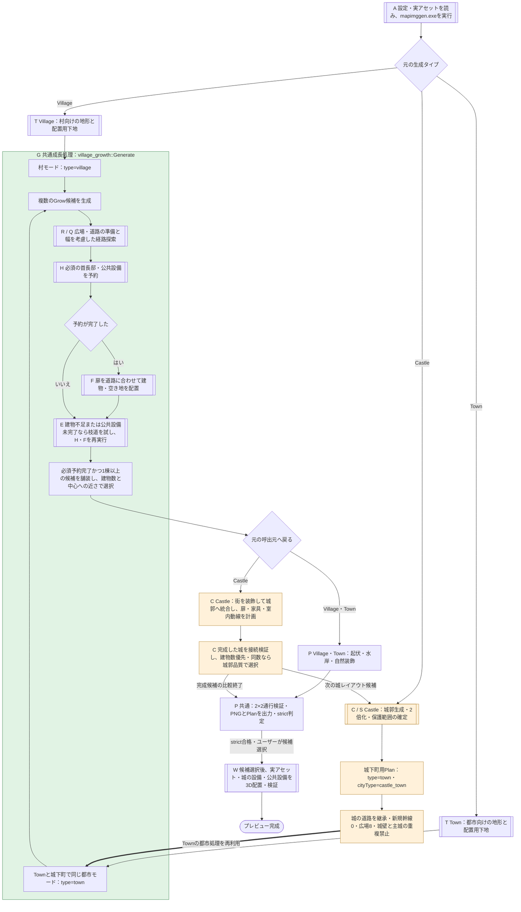

**続き：** 入力から順に追う場合は[A](#入力と実行)、街の共通処理は[G](#共通成長処理)、Castle固有の処理は[C](#城下町の統合)へ。

## A エディターから生成器へ渡す情報

**入力**はUIで選んだタイプ、サイズ、パラメータ範囲と、登録済みの実アセット群。**出力**は最大10枚の平面候補で、各候補がPNGとPlanを持つ。10回の試行のうち失敗したものは一覧へ追加せず、次のseedへ進む。この節は生成器を呼び出す外側の流れを示し、生成器内部の分岐をT・G・Cへ展開する。

実装：`MapGenDialog.sk` の `runSerialMapgen / execMapgen`、`MapGenerator.sk` の `constructionAssetParameters / generateSourceImage / parseopts`、`main.cpp`。

屋根や張り出しを含む実アセット全体の寸法と、外扉の位置を生成器へ渡す。外扉を識別できない建物は候補から外す。建物は4回転分を渡し、生成器側が実際に使える向きを絞る。

建物候補には名前由来の住宅判定 `asset{n}Residential` も付ける。家・屋敷・house・manor・mansion・residenceなどを住宅の手掛かりとし、店・ショップ・倉庫・アパート・宿などや、教会／城などの専用グループを除外する。これは建物として抽出できたアセットへの追加分類であり、名前だけで全アセットが建物候補になるわけではない。

Village・Town・Castleはいずれも `settlementCivicPlan=1` を渡す。井戸などの公共設備はネイティブオブジェクトから幅・奥行き・高さを取得し、`civicObject{type}_{variant}Width/Depth/Height` として渡す。Hの予約寸法とWの実配置寸法を一致させるための情報である。

通常のUI範囲はseedに従って具体値へ変換する。gateCount、towerCount、keepRoomCount、outerFacilityCount、moatWidthは例外で、Min/Maxとして生成器へ渡し、城レイアウト候補内で値を決める。

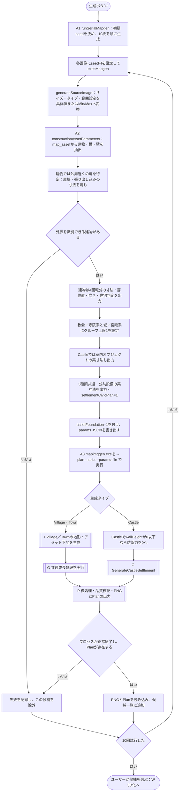

**続き：** Village/Townは[T](#地形と下地)、Castleは[C](#城下町の統合)へ進む。

## T Village と Town の地形と下地

**入力**はサイズ・seed・立地・向きと実アセット情報。**Gへ渡すもの**は全面の地形と建築可能範囲で、道路・建物配置はGが担当する。Castleの城下町はこの地形生成を通らず、Cで城の内側から用地を作る。

実装：`VillageMapImageGenerator.cpp / TownMapImageGenerator.cpp` の `Generate`、`SettlementSite.cpp` の `PrepareSettlementSite`、`AssetFoundation.h` の `BuildAssetFoundation`。

立地は plains、coast、mountain_valley、forest、river、lake、oasis の7種類。地形生成関数は共通で、村か都市かによって主に開拓範囲が変わる。全面の地形を表す `biomes` と、建築可能範囲の `settlementMask` は別々に保持する。

図の面積比は開拓範囲を選ぶ途中の上限であり、接近路の追加や樹木・崖の除外後の最終面積とは一致しない。BuildAssetFoundationの橋処理は既存の渡河が対象で、新規幹線による渡河は後段のQで扱う。

```mermaid
%% T: VillageMapImageGenerator.cpp、TownMapImageGenerator.cpp、SettlementSite.cpp、AssetFoundation.h。
%% assetFoundation=1。従来の建物・住民・家具を生成するCLI経路には進まない。
flowchart TB
    kind{"VillageかTownか"}
    village["Village：Planを初期化・village=true"]
    town["Town：32×32以上を確認・Planを初期化・village=false"]
    site["T1 立地を決定：指定値またはseed mod 7"]
    rotation["向きを決定：指定値またはfloor(seed / 7) mod 4"]
    skeleton["T2 MakeSkeleton：seedから本谷・支谷・河口・盆地の骨格を生成"]
    relief["地盤の高さ・硬さ・起伏を計算"]
    incision["谷を侵食し、谷底や合流部へ堆積"]
    water["低地の連結性と立地に応じ、川・海・湖・オアシスを形成"]
    nature["湿り気・傾斜・地盤から岩山・樹木と開拓コストを決定"]
    nucleus["T3 中心付近の乾いた地点を開拓の核にする"]
    search["地形コストを使った優先度付き探索で開拓可能セルを順序付け"]
    mask{"村向けの開拓範囲か"}
    small["Village：min 全面積×0.36、探索到達セル数×0.78"]
    large["Town：min 全面積×0.74、探索到達セル数×0.94"]
    approaches["森林・山谷では接近路を補い、樹木・崖を建築範囲から除外"]
    terrain["biomes・settlementMask・terrainHistoryへ保存"]
    identity["VillageはcityType=village、Townは指定またはseed由来の都市属性"]
    assetList["T4 BuildAssetFoundation：実アセットの寸法・分類・向きを確認"]
    available{"利用可能なアセットがある"}
    cleanup["旧構造・乾いた入口・メタデータを整理し、地形と対応可能な渡河を保持"]
    bridge["橋アセットは両端が陸地で全体が収まる場合に予約"]
    bridgeCleanup["対応する橋を確保できない旧BRIDGEをRIVERへ戻す"]
    growth[["G village_growth::Generateを呼ぶ"]]
    failure(["生成失敗を返す"])

    kind -->|"Village"| village --> site
    kind -->|"Town"| town --> site
    site --> rotation --> skeleton --> relief --> incision --> water --> nature --> nucleus --> search --> mask
    mask -->|"はい"| small --> approaches
    mask -->|"いいえ"| large --> approaches
    approaches --> terrain --> identity --> assetList --> available
    available -->|"いいえ"| failure
    available -->|"はい"| cleanup --> bridge --> bridgeCleanup --> growth

    classDef shared fill:#E1F3E4,stroke:#4D8F5E
    class site,skeleton,search,terrain,growth shared
```

**続き：** この地形と開拓範囲を[G](#共通成長処理)へ渡す。

## G 共通成長処理と街候補の選択

**入力**は地形・配置可能範囲・建物アセット・道路設定。**出力**は、道路、広場、建物敷地、空き地、入口を持つ採用済みPlan。Village/Townからの呼出しはPの高さ調整へ戻り、Castleからの呼出しはCの統合処理へ戻る。

関数名にvillageが含まれるが、内部の `urban = (plan.type == "town")` により都市処理へ分岐する。G自体は城郭を作らず、渡された建築可能範囲の中で配置する。

実装：`VillageGrowth.h` の `Grow / Generate`、`SettlementCivic.h` の `Wealth / Program`。

Generateは毎回元の地形をコピーする。前の候補で置いた道路や建物を、次の候補へ持ち越さない。候補の順番によって乱数系列を変え、3候補に1回は小さな建物を優先する。

採点は `建物数×1000 − 建物中心から広場中心へのユークリッド距離合計×0.1`。首長邸も建物数と距離合計に含む。公共設備は建物数に含めず、採点で優劣を付ける前の必須条件として扱う。目標件数は必達条件ではないが、**必須の首長邸・公共設備をすべて確保し、1棟以上置くこと**がGrowの成功条件になる。接続検証はこの最高点選択の後、呼出元で実施する。

裕福度はパラメータの `countryWealth` を優先し、未指定ならPlanの値を使って0.7〜2.5へ制限する。2.0以上では、条件に合う大型住宅アセットがなければ道路生成前に候補を失敗とする。アセットはあるが置き場所が足りない場合は、HとEで場所を探す。

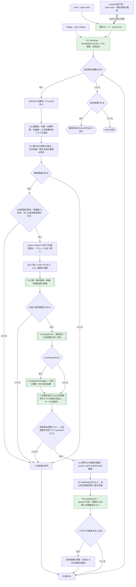

**詳細：** 1候補の内部は[R](#広場と道路) → [H](#公共設備と首長邸) → 予約完了なら[F](#沿道への配置) → [E](#枝道の追加)。E内でもHを再試行する。採用後は[P/W](#検証と3D化)、Castleから呼ばれた場合は[C](#城下町の統合)へ戻る。

## R 広場と初期道路の生成

**入力**はGの候補1件分の地形・用地・道路設定。**出力**は広場、幹線、初期枝道と、道路の階層を表すrankである。HとFはこのrankを参照して設備・建物の接道先を決める。

実装：`VillageGrowth.h` の `Grow` 前半、`square / route / paint`。

`base=clamp(assetRoadWidth,2,6)`、幹線幅は `4×base`、枝道幅は `2×base`。エディター初期値base=2なら、幹線8セル・枝道4セルになる。建物の扉への接続路は別に幅2で作る。

中心候補の得点は `周辺の空き標本数×0.35 − 地図中心へのマンハッタン距離×0.6 − min(40, abs(水域距離−12))×0.3 + 乱数0〜8`。水辺立地では、これに加えて広場の外縁が岸に接する条件を課す。

Castleの城下町は広場幅8を指定し、継承道路を含む位置に広場を置く。`villageMainRoadCount=0` でも、広場から局所道路を試し、後段Eでも必要な枝道を増やす。

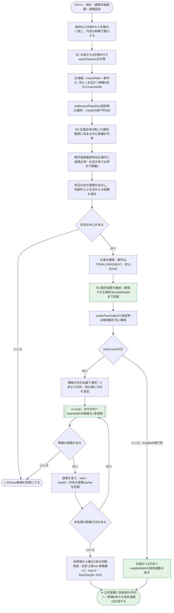

**詳細と続き：** 道路1本の探索は[Q](#道路探索)。初期道路ができたら[H](#公共設備と首長邸)へ進む。

## Q 道路幅を含む経路探索

**入力**は開始点、進みたい方向、幅、幹線か枝道か、最大長。**戻り値**は経路のセル列、または空の経路。route自身は地形を塗り替えず、呼出元のpaintが返された経路を道路へ変える。

実装：`VillageGrowth.h` の `route / square / paint`。

探索点は道路の左上に相当する座標で、判定対象は指定幅の正方形全体。BFSで探索し、単に最短の終点ではなく、進行方向と横ずれの評価がよい終点を選ぶ。地形コストを使うTの開拓探索とは別の探索である。

幹線は開拓範囲の外へ延長できる。枝道は開拓範囲内を通り、既存道路に沿って横滑りする経路を避ける。川の横断は幹線だけが試し、前後の陸岸を確認する。海と湖は橋で横断しない。

図は隣接セルの条件判定をまとめて表す。未訪問・後退量・道路干渉・地形・幅の条件をすべて満たすセルだけが探索へ追加される。

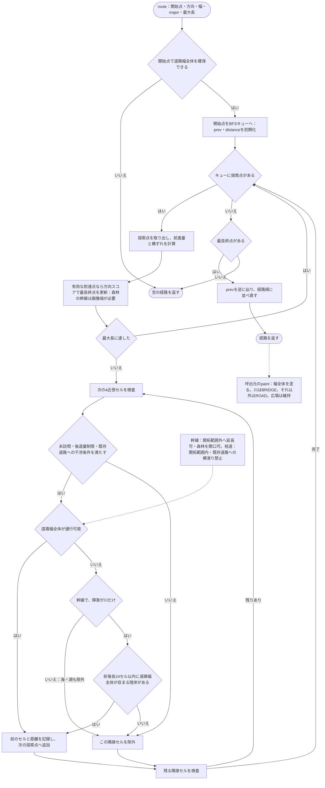

**戻り先：** 初期道路を作る[R](#広場と道路)、または追加枝道を試す[E](#枝道の追加)へ経路を返す。

## H 公共設備と首長邸を一般住宅より先に予約する

**入力**は中心・道路・占有状態、裕福度、建物候補、公共設備の実寸法。**戻り値**は必須予約を完了できたかどうかで、Plan・occupied・placed・needsMayor・civicReadyを更新する。初期道路生成後と、Eで枝道を仮設した直後に、同じ `prepareCivic` を呼ぶ。

実装：`SettlementCivic.h` の `Wealth / Program`、`VillageGrowth.h` の `civicFronts / reserveCivicLot / prepareCivic`。

### 裕福度と必須の配置内容

設備は下表の順に累積する。抽選で置く装飾ではなく、該当するものを各1個確保する。エディターでは3種類とも有効だが、生成器を直接呼び `settlementCivicPlan` を省略または0にした場合はHを省略し、`civicReady=true` で開始する。

| countryWealth | 必須の公共設備 | 設備数 | 首長邸 |
|---|---|---|---|
| 0.7以上1.0未満 | 共同井戸 `community_well` | 1 | 不要 |
| 1.0以上1.5未満 | 井戸＋ベンチ `public_bench` | 2 | 不要 |
| 1.5以上2.0未満 | 上記＋街灯 `square_lamp` | 3 | 不要 |
| 2.0以上2.5以下 | 上記＋露店 `market_stall`＋像 `civic_statue` | 5 | 必須：大型住宅1棟 |

境界は「以上」で判定する。例えば1.999なら設備3個・首長邸なし、2.0なら設備5個・首長邸1棟になる。設備のネイティブ種別／種類は、井戸3/26、ベンチ4/5、街灯2/1、露店3/11、像3/14。これらはFreeBlock作成時の種別番号であり、ビットマスク値ではない。寸法はAが渡した実寸法を優先し、未指定時だけ生成器側の既定寸法を使う。

### 予約する場所と順番

1. **首長邸のアセットを絞る。** Gで抽出した建物のうち、`residential=true`、`limitGroup=0`、南向きの外扉 `side=2`、外形の長辺が12ブロック超のものを使う。裕福度2.0以上で該当候補がない場合はGrowを即座に失敗とする。
2. **中心付近の接道候補を作る。** `middleWidth` 以上で、入口前2セルの道路階層が一致する場所を探す。広場の縁も対象にできる。広場中心から道路上の接続点までのユークリッド距離が32セル以内のものを近い順に並べる。ここで測るのは建物中心までの距離ではない。
3. **首長邸を先に予約する。** 外形の面積が大きいアセットから試し、各アセットについて近い接道候補から探す。南向きに置ける場所だけを使う。成功すると `needsMayor=false` にし、`placed` を1増やす。一般配置Fの向き別抽選は通らない。
4. **公共設備一式を予約する。** 同じ接道条件のうち距離24セル以内で、井戸 → ベンチ → 街灯 → 露店 → 像の順に、該当する設備を置く。向きは接道方向から `(side+2)%4` で決め、奇数回転なら幅と奥行きを入れ替える。
5. **すべて置ければ一般配置を解禁する。** `civicReady=true` とし、Fへ進む。Fは首長邸・公共設備の予約済み敷地を避け、残った沿道へ建物を置く。

首長邸も公共設備も、敷地と周囲2セルに占有・道路がなく、乾いた建築可能範囲に収まることが必要である。地図端からの余白も確保し、周囲3セルに接道先より太い道路がある場所を除く。予約時は周囲2セルをoccupiedにし、都市なら石床、村なら草地または砂地へ変える。首長邸本体は木床にし、実際の外扉へ幅2の接続路を作る。設備にも道路向きの出入口位置を定め、幅2で接続する。

首長邸は `asset_plot` に `residentProfile="village_head"`、`livingArrangement="mayors_residence"` を付け、`asset_approach` と `settlement_mayor` を記録する。設備は `settlement_facility` と `settlement_facility_access` に記録する。これにより、後処理と3D化がそれぞれの敷地・接続点・実体を追跡できる。

### 失敗時に戻す範囲

公共設備は一式で確保する。途中の1個でも置けなければ、**設備を置き始める直前**のPlanとoccupiedに戻す。この退避は首長邸の予約後なので、先に置けた首長邸はH内では残る。首長邸自体が置けなければ設備には進まない。

Hが未完了なら一般配置Fを実行せず、Eで枝道を増やしてHを再試行する。Eにはさらに試行全体の退避があり、建物増加も公共設備予約の完了もなかった場合は、枝道を作る前の状態まで戻す。したがって「設備一式の取り消し」と「枝道試行全体の取り消し」は別の範囲である。

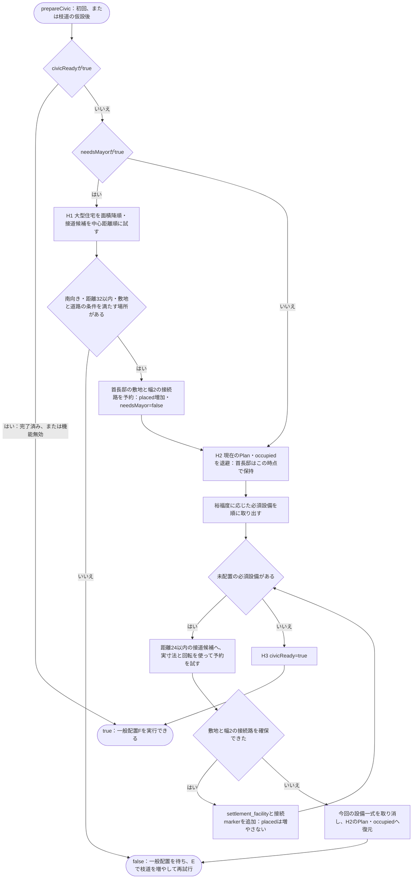

**続き：** 完了したら[F](#沿道への配置)。未完了なら[E](#枝道の追加)で再試行する。Eを終えても首長邸や設備が不足していれば、[G](#共通成長処理)はその候補を採用しない。

## F 扉位置に合わせた沿道への配置

**入力**は現在の道路・占有範囲・配置済み件数。**出力**は追加した敷地と扉への接続路、更新した件数・占有情報である。同じ関数を初回の配置と、Eで枝道を試した直後の配置に使う。どちらもHの予約が完了していることが実行条件となる。

実装：`VillageGrowth.h` の `populateFrontages`、`SettlementAssetPolicy.h`。

アセット外形の長辺が12ブロックを超える建物は前後方向だけを使い、小さな建物は側面方向も使える。沿道ごとの採用判定はseed・座標・向きで固定し、別アセットや別回転を試しても再抽選しない。

`northFacingHouseKeepPercent` の初期値は10、`sideFacingHouseKeepPercent` は75、残る向きの採用率は100。採用されない区画は、空き地予算内なら畑・公園・空き地になる。空き地の上限は `max(1, floor((target+3)/4))`。

建物と周囲2セルの敷地を確保し、扉が中央からずれていても実際の扉位置へ接続路を作る。教会／寺院系、城／宮殿系はそれぞれ同じグループとして上限1。Castleでは既に主城があるため、城／宮殿アセットを抽出時点で除外する。

Hで置いた首長邸はplacedに含まれる。例えばtarget=20で首長邸を1棟置いた場合、Fで追加する建物は最大19棟になる。公共設備5個を置いてもplacedは増えない。首長邸はFの一般建物向け抽選より前に確保され、空き地へ置き換わることもない。

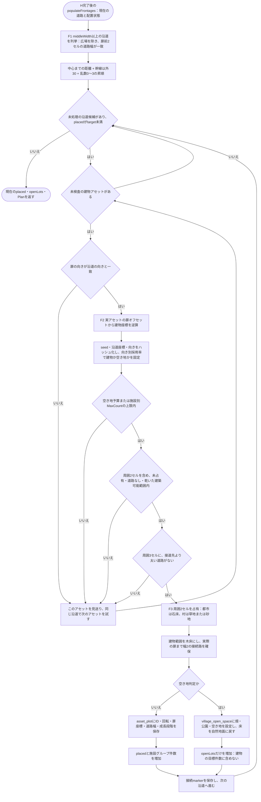

**続き：** 建物数が不足していれば[E](#枝道の追加)へ。枝道試行の途中なら、Eが建物数の増加または公共設備予約の新たな完了を判定する。

## E 枝道の追加と取り消し

**入力**は初回Hの試行後の状態。Hが完了していればFの配置結果も含む。**出力**は採用できた枝道・首長邸・公共設備・一般建物を反映した状態である。追加できなくなったらGへ戻り、必須予約の完了と1棟以上の配置を確認する。

実装：`VillageGrowth.h` の `Grow` 内、初回 `prepareCivic` の後にあるwaveループ。

ループ条件は `(placed < target || !civicReady) && wave < target+8`。1回の成長段階で最大32本の枝道候補を試し、空き地の多さと中心への近さで順位付けする。枝道を仮設してHを再試行し、Hが完了した場合にFを実行する。

採用条件は `placed > 試行前のplaced` **または** `試行前はcivicReady=falseで、現在はtrue`。首長邸だけ増えた場合も建物増加として採用し、設備の不足は次の段階で引き続き解消する。公共設備がそろっただけで建物が増えない場合も採用できる。採用後は候補一覧を作り直して次の成長段階へ進む。

どちらの進展もなければ、Plan、道路階層・所属、占有情報、乱数状態、施設件数、空き地数に加え、needsMayorとcivicReadyを戻す。H完了済みで畑や公園だけが増えた試行も採用しない。正面／背面向きの建物しか置けない条件では、南北の接続路と東西の接道用道路を一度に試す。

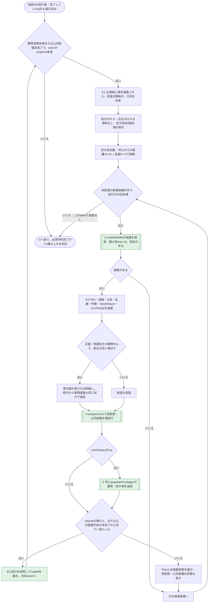

**戻り先：** [G](#共通成長処理)で必須予約の未完了・0棟を除外し、成功候補を舗装・採点する。目標件数に届かないことだけでは失敗にしない。

## C Castle が街の処理を呼び出す流れ

**入力**は元のCastle用設定と実アセット情報。**出力**は城郭・主城・城下町・室内配置を含む1つのPlan。生成途中だけ、元の城を保持するPlanとは別に `type="town"` の城下町Planを用意する。

| 城下町へ渡す指定 | 理由 |
|---|---|
| type=town、cityType=castle_town | Townと同じ都市モードに入る |
| settlementMask | 主城、塔、門楼、防御帯、水域、訓練場を街の配置から守る |
| preserveSettlementRoads=1 | 門と主城へ続く道路を街の基盤として使う |
| villageMainRoadCount=0 | 城外へ伸びる幹線を新たに作らない。城内の局所道路は作る |
| settlementPlazaSize=8 | 城内の配置可能範囲に合わせて広場を固定する |
| wallHeight=0 | 街の境界壁を重ねて作らず、元の城郭が外壁を管理する |
| existingRoyalResidence=1 | 主城に加えて別の城／宮殿アセットを配置しない |
| countryWealth=元の城Planの裕福度 | 城と城下町で同じ裕福度を使い、公共設備・首長邸の要否をそろえる |
| settlementCivicPlan=1と設備実寸法を引き継ぐ | Townと同じHで公共設備と首長邸を予約する |

ここで直接呼ぶのはGの共通関数である。Town全体の地形生成を城内で最初からやり直す処理にはならない。

実装：`CastleSettlement.h` の `GenerateCastleSettlementCandidate / GenerateCastleSettlement`。

外側の候補ループは「城郭と城下町が完成した1組」を比較する。各候補について半サイズの城郭を1案生成し、内部でGを呼んで複数の街候補を試す。Castle自身の保護領域を街の配置可能範囲から除くことで、共通の街生成処理が主城や城壁を上書きしない。

継承する道路は、主城入口から門へ通じる経路を元に絞る。置き換える仮施設への不要な枝道を残さず、実アセットの敷地を確保する。街が完成したら、そのbiomesと領域・markerを城へ統合し、参照番号を補正する。

**主城と首長邸は別の条件である。** `existingRoyalResidence=1` が除外するのは城／宮殿グループのアセット。Hの首長邸は住宅グループ0から選ぶため、城の裕福度が2.0以上なら既存主城があっても首長邸1棟が必要になる。主城があることを理由にHを省略する分岐はない。

完成候補はまず接続検証を通す。公共設備の接続点と首長邸markerも検証対象になる。その後、首長邸を含む `asset_plot` の件数が多い候補を選び、同数ならSで計算した城郭のqualityScoreを比較する。これはGの街候補スコアとは別である。

C6の室内処理は `CastleInterior.h` の `Decorate`。扉寸法と出入口の空間を確認し、玉座と謁見空間を先に確保する。各扉を室内の中心へ接続し、一般室4セル・公的な広間6セルを基本とする通路帯を予約してから用途別の家具を置く。配置前後に到達性と幅4の室内経路を確認し、通路や家具への接近が塞がれば、その城候補を除外する。

室内計画の占有マップでは、街の建物だけでなく `settlement_facility` の範囲も障害物として扱う。街の自然装飾も公共設備とその接続点を避けるため、Hで予約した場所が後段で使い回されない。

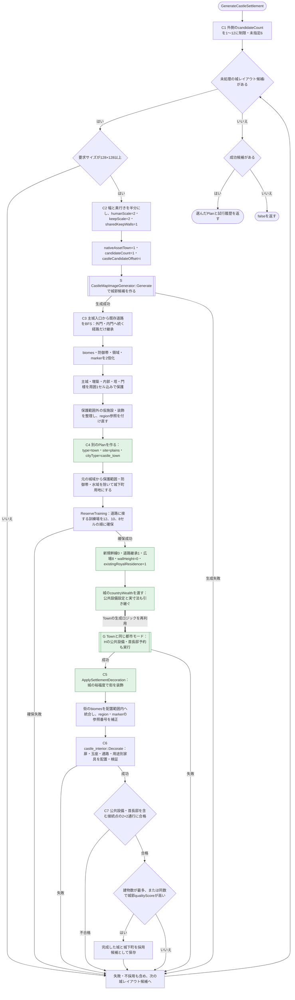

**詳細：** 城郭は[S](#城郭の生成)、城下町は[G](#共通成長処理)で生成する。完成候補を選んだ後は[P/W](#検証と3D化)へ。

## S 城郭そのものの生成

**入力**はCで半分にしたサイズと、城の型・規模・防衛などの設定。**出力**は主城、部屋、門、塔、道路、仮施設を持つ城郭Plan。Cはこれを2倍化し、保護すべき部分を保持したまま、仮施設の一部を実アセットの街へ置き換える。

実装：`CastleMapImageGenerator.cpp:640–2023`。Cから呼ぶ際は `candidateCount=1`、`nativeAssetTown=1`、`sharedKeepWalls=1`。

型・裕福度・防衛力はレイアウト候補を変えても同じseed系列から決まり、別の型へ切り替えて成功させる探索は行わない。防衛力は裕福度と別に決める。エディターのwallHeightが0以下ならmain側で防衛力を0にする。

城郭段階でも、Town用の `ApplyTownPaving` を再利用する。これはGの最後に行う都市モードの道路舗装とは別の処理。Sの仮施設や舗装の一部は、後段Cで実アセットの城下町へ置き換わる。

図は城郭形成の主要段階を表す。門・塔・部屋・接続路が指定条件で収まらなければ、その候補を失敗としてCへ戻す。S内のEvaluateMapQualityは採点に使い、完成した城下町の接続検証はCで別途行う。

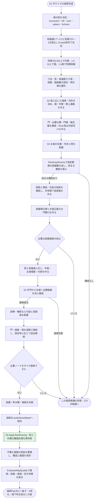

**戻り先：** [C](#城下町の統合)が2倍化、街用地の確保、Townと共通の都市処理への引き渡しを行う。

## P と W 後処理から3D化まで

**Pの入力**は採用された平面Planで、**出力**は品質結果・PNG・Plan JSON・終了コード。**Wの入力**はユーザーが選んだ平面候補で、**出力**は建物・装飾を配置した3Dワールドと表示・衝突判定用のデータである。

実装：`main.cpp`、`AssetFoundation.h` の `EvaluateAssetFoundation`、`SettlementRelief.h`、`SettlementDecoration.h`、`MapGenDialog.sk` の `selectMapgen`、`MapGenerator.sk` の `generate / toBlockWorld / placeSettlementFacilities`。

Pの接続検証は、2×2セルすべてがROAD・BRIDGE・TOWN_PAVEMENTのいずれかである場所を通り、対象markerへ到達できるかを調べる。Castleでは主城入口・建物入口・広場・空き地入口・城門側の接続に加え、`settlement_facility_access` と `settlement_mayor` も対象とする。Village/Townはmarkerを種類で限定しないため、追加された接続点も対象になる。室内の詳細検証はC6で行う。この段階の2×2判定は平面の道路タイルに基づき、3Dオブジェクトの形状全体を用いた判定ではない。

Village/Townの起伏・水岸調整は公共設備の敷地と周囲2セルも保護する。共通の装飾計画は設備の周囲2セルと接続markerの周囲3セルを予約し、3D側の自然物配置でも設備の周囲を避ける。Castleは起伏・水岸の後処理を通らず、Cで装飾・室内計画まで済ませる。

PNGとPlan JSONはstrict判定より前に書き出される。ファイルが存在しても、終了コード7ならエディターは生成失敗として扱う。画像サイズ、Planのseed、biomesの要素数も読み込み時に確認する。失敗があったバッチは成功件数と最初のエラーを通知し、再現用の入力・出力を一時フォルダーに残す。

3D化はユーザーが候補を選んだ時に実行する。表示中の候補だけ3Dワールド・メッシュ・衝突判定を保持し、別候補へ切り替えた後に再選択すると、同じseedから高さ・装飾を再構築する。新しい3Dデータが完成するまで直前の表示と選択を保持し、例外時は不完全なキャッシュを公開しない。生成中・選択処理中は設定変更、候補選択、適用、コピー、ダイアログを閉じる操作を止める。再生成前には、削除されるサムネイルの選択参照を解除する。

公共設備の最終検証では設備ごとの区画内だけを検索する。森林全体を一括取得すると、多数の樹木を含む候補でネイティブ処理が異常終了する経路があったためである。選択候補のseedと3D化の進行段階は `tmp/mapgen/last_preview_stage.json` に保存する。

3D側では全建物の寸法・扉・向き・重複・範囲・平坦性・高さを検証してから統合する。その後、城門 → 自然装飾 → 城の室内オブジェクト → 公共設備の順に配置する。公共設備を最後に置く `placeSettlementFacilities` は3種類に共通で、次を検証する。

1. 首長邸のアセットが長辺12超で、回転後の外扉も南向きであること。
2. 各公共設備の回転後の幅・奥行き・高さが、Planに記録した値と一致すること。
3. 設備の敷地全体で地面の高さが等しく、地面の1段上から設備の高さ分まで空いていること。
4. 中心領域と公共設備が存在し、首長邸が裕福度2.0以上なら1棟、それ未満なら0棟であること。
5. 配置後にワールドのFreeBlockを再収集し、予定した各設備の種別・種類・位置・寸法が一致する実体があること。

Hが裕福度ごとの設備一式を要求し、WはPlanにある設備の実体を検証する。Wで裕福度別の設備一覧を改めて作り直すわけではない。検証成功後は `tmp/mapgen/last_settlement_civic.json` にseed・生成タイプ・裕福度・中心・首長邸・設備と `finalWorldChecked=true` を保存する。

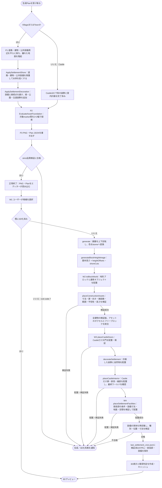

**補足：** 具体的な分岐は[処理例](#具体例)、失敗時の挙動は[戻り先の表](#失敗時の戻り先)で確認できる。

## 具体例で処理を追う

以下の件数・得点は分岐を説明する仮定であり、特定seedの生成結果ではない。

### Townで枝道を増やす例

1. 建物の目標を20棟、基本道路幅baseを2とする。幹線は8セル、枝道は4セル、扉への接続路は2セルになる。
2. Tで地形と開拓範囲を決める。Gの候補1件目は、その地形をコピーして開始する。
3. 裕福度を1.5とする。Rで広場と幹線・初期枝道を作り、Hで井戸・ベンチ・街灯を確保する。首長邸は不要で、civicReady=trueになってからFで沿道へ10棟配置できたとする。
4. Eで枝道を仮設する。Hは完了済みなので直ちにtrueを返す。Fを再実行して12棟に増えたなら、その枝道・建物・占有状態を採用する。
5. 次の枝道試行で建物は12棟のまま、公園だけが1区画増えたとする。この試行は取り消し、公園も枝道も試行前へ戻す。
6. 他の枝道候補でも建物が増えなければ、必須設備は確保済みなので、目標20棟に届かなくても12棟でこの候補を完成させる。
7. 12棟の中心から広場までの距離合計が300なら、Gの得点は `12×1000−300×0.1=11970`。別候補が13棟・距離合計400なら `12960` となり、その別候補を選ぶ。
8. 採用されたPlanにPで高さ調整・装飾・接続検証を行う。設備敷地も平坦なまま保護する。検証に合格すると平面候補として表示され、選択時にWで実アセットと公共設備を3D配置する。

「街候補を作り直すGのループ」と「同じ候補に枝道を増やすEのループ」は別である。Eが戻すのはその枝道試行の直前の状態で、Gが次の候補へ進むときは最初の地形からやり直す。

### 裕福度2.0で公共設備の予約が途中までしかできない例

1. Gは、南向き外扉を持つ長辺12超の住宅候補があることを確認する。該当候補がなければ、この時点でGrowは失敗する。
2. Hで首長邸を1棟確保した後、井戸・ベンチ・街灯は置けたが、露店が入らなかったとする。公共設備は一式を取り消し、首長邸1棟だけを保持する。civicReady=falseなので一般配置Fはまだ実行しない。
3. Eで枝道を試し、新しい沿道へ設備5個がすべて収まるとcivicReady=trueになる。その試行では一般建物が増えなくても、公共設備予約が未完了から完了へ進んだため採用する。
4. 以後はF/Eで残りの建物を目指す。目標に届かなくても、首長邸・設備5個・1棟以上の建物という必須条件を満たしていればGrowは成功できる。首長邸自体が1棟として数えられる。
5. 設備をそろえられないままEの候補が尽きた場合は、首長邸が置けていてもGrowを失敗とし、Gの次の街候補へ進む。

初回Hで首長邸も置けなかった場合、Eの試行中に首長邸だけ新たに置けた段階でも、placedの増加によってその試行を採用する。これと「設備がそろっただけでも採用する」条件の両方が、現在のEにある。

### CastleでTownの都市処理を使う例

1. Cが城レイアウト候補を1つ開始し、Sで主城・城壁・門・主要道路を生成する。
2. Cで城郭を2倍化する。主城や防御帯を保護し、その外側の城内用地を城下町用のsettlementMaskにする。
3. 門と主城へ続く道を残し、道路に接する訓練場を先に予約する。
4. 別のPlanを `type="town"` で作り、城のcountryWealthをパラメータへ渡す。GはこのPlanを見て、通常のTownと同じ都市モードに入る。
5. 新規幹線0本・広場8セル・既存道路継承という設定でRを実行する。城内の局所道路を基にH/F/Eで開発する。城の裕福度が2.0なら、Hで公共設備5個と、主城とは別の首長邸1棟を確保する。
6. Gが複数の街候補から1案を返したら、Cが街を装飾し、元の城郭へ統合する。元の主城と防御帯は残る。
7. 室内の扉・通路・家具を計画して接続を検証する。失敗すれば、この城レイアウト候補を捨てて次の候補へ進む。
8. 接続検証に合格した完成候補を比較する。例えば「城下町8棟・城郭得点500」と「城下町9棟・城郭得点400」なら、Cは9棟の候補を選ぶ。この件数には首長邸を含み、公共設備は含まない。同じ建物数のときだけ城郭得点を比較する。

城下町の配置中は都市Planを使うが、完成した成果物の生成タイプはCastleである。Gの都市モードへ入るためのtypeと、完成マップの生成タイプを混同しない。

## 失敗時の戻り先

「配置できない」の扱いは、どの段階で発生したかによって異なる。

| 発生箇所 | 代表的な条件 | 処理の戻り先 |
|---|---|---|
| A アセット抽出 | 外扉を識別できない建物 | そのアセットを除外。利用できる建物がなければ生成失敗 |
| G 首長邸候補の抽出 | 裕福度2.0以上なのに、条件に合う大型住宅アセットがない | 道路生成前にGrowを失敗にする。Gの全候補でも同じ条件を要求する |
| R 広場・幹線 | 乾いた広場が収まらない、指定した幹線を作れない | Growを失敗にし、Gの次の街候補へ |
| Q 経路探索 | 幅を確保できる経路や有効な終点がない | 空の経路を返す。必須幹線なら候補失敗、任意の枝道なら別の場所を試す |
| H 首長邸予約 | 候補アセットはあるが、南向き・中心近くの敷地に収まらない | falseを返してFを待ち、Eの枝道試行でHを再実行する |
| H 公共設備予約 | 必須設備のうち1個でも置けない | 今回の設備一式だけを取り消す。Hで先に確保した首長邸は残してfalseを返す |
| F 建物配置 | 向き・施設数・敷地・道路階層の条件に合わない | 同じ沿道で別アセットを試し、尽きたら次の沿道へ |
| E 枝道試行 | 建物数が増えず、公共設備予約も未完了から完了に変わらない | 首長邸・設備のフラグを含む全試行状態を復元し、次の枝道候補へ |
| E 成長終了 | 追加可能な枝道がない、最大target+8段階に達した | 現在の配置をGへ返す。目標件数未達だけでは失敗にしない |
| G 候補完成 | 必須の首長邸・公共設備が未完了、または建物が0棟 | その候補を除外。すべて失敗なら呼出元へfalseを返す |
| S 城郭生成 | 必要な部屋・門・接続が収まらない | Cの次の城レイアウト候補へ |
| C 城下町と室内 | 訓練場が確保できない、街生成失敗、室内計画や接続検証に失敗 | その完成候補を除外し、次の城レイアウト候補へ |
| P strict判定 | 採用済みPlanの接続などに品質問題がある | 異常終了コードをエディターへ返す |
| W 3D配置 | アセット・設備の寸法変更、首長邸の扉条件不一致、地面の段差、障害物、設備実体の欠落など | 例外として3D化失敗を通知 |

Village/Townでは、Gは得点で街候補を1案選び、Pがその案を接続検証する。Pで失敗したときに、Gの次点候補へ自動で切り替える処理はない。一方、CastleはCの候補比較に接続検証を含めており、不合格の城候補を除外してから採用案を決める。

PNGとPlan JSONが存在することと、生成に成功したことも別である。Pはファイルを書いた後にstrict判定を行うため、エディターは終了コードも確認する。平面計画に合格した後も、Wでは実際のアセットとワールドを再検証する。

## 設定を変えたときの影響

| 設定 | 主に作用する段階 | ロジック上の変化 |
|---|---|---|
| seed | T、G、C、S | 地形・候補の乱数系列・沿道の採用判定などが変わる |
| settlementSite / siteRotation | T、R | 地形と向きが変わり、水辺・森林などの中心選定や道路条件に反映される |
| assetPlotCount | G、H、F、E | 首長邸を含む目標建物数と、最大target+8段階の成長範囲が変わる。必須予約が完了していれば指定数未満でも成功できる |
| assetRoadWidth | G、R、Q | 基本幅から幹線幅・枝道幅を決める。幅を増やすと経路全体に必要な空間も増える |
| villageMainRoadCount | R | 広場から伸ばす幹線の本数が変わる。Castleの城下町では0へ上書きされる |
| candidateCount | G、C | 街候補の比較数が変わる。Castleでは外側の城候補数にも使う |
| northFacingHouseKeepPercent / sideFacingHouseKeepPercent | F、E | 一般配置の向き別採用率と、側面建物を置けない場合の枝道試行に作用する。Hの首長邸はこの抽選を通らない |
| townCityType | T、G | 都市属性を設定する。共通成長処理ではpaved_cityが全ROADを舗装する分岐に使われる |
| wallHeight | A、G、C、W | 正なら集落境界壁を計画する。Castleで0以下なら防衛力も0へ設定。城下町側では常に0へ上書き |
| terrainRelief | P、W | 道路や建物から離れた地面の隆起量に作用する。Castleの城下町はこの後処理を通らない |
| countryWealth | G、H、P、S、C、W | 必須公共設備の段階と、2.0以上での首長邸を決める。自然装飾・城の構成にも作用し、防衛力とは独立。Castleは城の値を街へ渡す |
| settlementCivicPlan | A、G、H、E、W | エディターは3種類とも1。生成器側で無効ならHを省略し、Wの公共設備配置も行わない |
| asset{n}Residential / civicObject実寸法 | A、G、H、W | Aが内部パラメータとして渡す住宅判定と設備寸法。首長邸候補・設備敷地・3D寸法照合に使う |
| castleMode / outerWallDefenseStrength | S | 城の構成と、外壁・堀・防御設備の有無や程度に作用する |
| keepWidthRatio / keepDepthRatio | C、S | 主城の寸法を決める。主城が占める用地は城下町の配置対象から外れる |

同じ設定でも、実アセット群の寸法や外扉が変わると、置ける沿道や候補の評価が変わる。再現条件にはseedだけでなく、サイズ、設定値、アセット群、実装も含まれる。

現在は裕福度が街の配置順と敷地予約にも作用するため、同じseedで裕福度だけを上げても、同じ街に装飾だけが追加されるとは限らない。特に2.0の境界では首長邸と設備2種が加わり、一般建物の配置や候補の成否も変わり得る。

## 実装対応表

本文中のエディター側ファイルは、このリポジトリの `project/plugin/rpgtools/mapeditor/` にある。生成器側のファイルは `rpgcobo-mapgen/src/` にあり、この作業環境では `C:/Users/You/github/rpgcobo-mapgen/src/` に配置されている。関数名を検索すると処理を追える。残している行番号は照合時点の目安である。

| 節 | ファイルと主要関数 | 担当 |
|---|---|---|
| A | MapGenDialog.sk: runSerialMapgen / execMapgen | seedを変えた10枚の生成 |
| A | MapGenerator.sk: constructionAssetParameters / generateSourceImage / parseopts | アセット情報・設定の変換と生成器の実行 |
| T | VillageMapImageGenerator.cpp / TownMapImageGenerator.cpp: Generate | エディター用の地形準備分岐 |
| T | SettlementSite.cpp: PrepareSettlementSite | 地形形成と開拓範囲 |
| T | AssetFoundation.h: BuildAssetFoundation | 実アセット用の下地と共通成長処理への呼出し |
| G | VillageGrowth.h: Generate / Grow | 候補選択と1候補の成長 |
| R/Q | VillageGrowth.h: square / route / paint | 幅を考慮した道路の探索と塗画 |
| H | SettlementCivic.h: Wealth / Program | 裕福度の決定と必須設備の段階 |
| H | VillageGrowth.h: civicFronts / reserveCivicLot / prepareCivic | 首長邸・設備の優先予約と設備一式の取り消し |
| F | VillageGrowth.h: populateFrontages | 接道条件に従う敷地・扉接続の計画 |
| F | SettlementAssetPolicy.h: SettlementBuildingOrientationAllowed | 建物寸法と向きの制限 |
| E | VillageGrowth.h: Grow内のwaveループ | 枝道の追加試行と状態復元 |
| C | CastleSettlement.h: GenerateCastleSettlement / GenerateCastleSettlementCandidate | 城全体の候補選択と城下町の統合 |
| S | CastleMapImageGenerator.cpp: Generate / PlanKeepRooms | 城郭、主城、部屋、門、道路 |
| S | TownPaving.cpp: ApplyTownPaving | 城郭段階で再利用する舗装処理 |
| C | CastleInterior.h: ReserveTraining / Decorate | 訓練場・室内の動線と設備 |
| P | SettlementRelief.h / SettlementDecoration.h | 起伏・水岸・自然装飾 |
| P | AssetFoundation.h: EvaluateAssetFoundation、main.cpp | 接続検証、ファイル出力、strict判定 |
| W | MapGenDialog.sk: selectMapgen、MapGenerator.sk: generate / toBlockWorld | 選択された計画の3D化と検証 |
| W | MapGenerator.sk: placeSettlementFacilities | 公共設備の実配置・首長邸条件・最終ワールド検証と監査JSON |

生成器側の `tests/SettlementCivicTests.cpp` と `tests/VerifySettlementCivic.cjs` には、裕福度の境界、必須設備、首長邸、中心からの距離、接続・実配置などの検証がある。これらのテストの判定と、Pで実行される道路タイルベースの検証は区別する。PR作成時にReleaseビルドとCTest全12件の成功を確認した。エディター側では村3候補の表示と配置データを検証し、森林のseed 27322326で公共設備検証中の異常終了を再現した後、区画単位の取得に修正して同じデータの3D化が2回成功した。森林の最終修正後の画面操作と、最新mainへ統合したチェックアウトでの実機テストは未実施。
